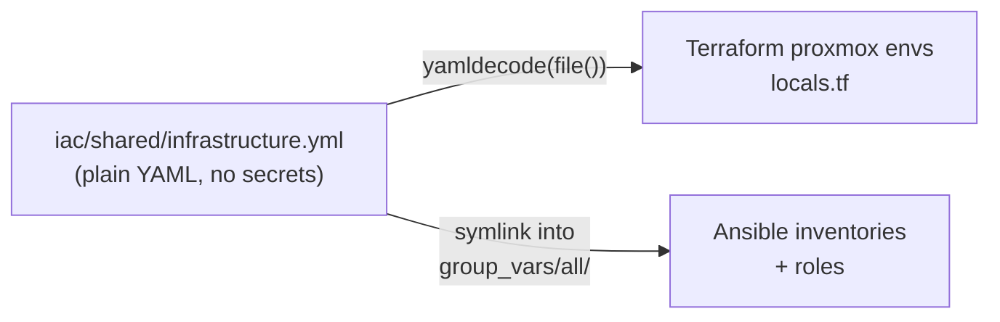

# Plan: NUT Refactor, Shared Variables, Secrets Audit, Docs & AI Tooling

> **Status:** Approved — in progress
> **Created:** 2026-11-10
> **Branches:** one branch per step. Step 1 = `UPS-NUT`.

## Decisions (2026-11-10)

| # | Decision |
| :- | :--- |
| Housekeeping | ✅ Deleted `nut_*.diff`. ✅ Added `*.diff` to `.gitignore` (Ansible section). ✅ Removed `pbcopy`/file output from `ups-nut-check`. |
| NUT review | For each template, show the check diff against the stock file it replaces. Added concise header/section comments to all NUT templates and scripts. |
| Reminder | Before finishing: (1) handle all `TODO` and `DELETEME` markers, and (2) **rotate NUT `USER_PASSWORD` and `ADMIN_PASSWORD` in Infisical (`/ansible/nut`), re-deploy, and set `diff: false` on `upsd.users` and `upsmon.conf`.** |
| Q1 | ✅ Use `iac/shared/infrastructure.yml` (loaded via `yamldecode(file(...))` in Terraform and `lookup('ansible.builtin.file', ...) | from_yaml` in `iac/ansible/inventories/group_vars/all.yml` — no symlinks) |
| Q2 | ✅ Move role to `roles/proxmox/nut/` |
| Q3 | ✅ `proxmox` is the instance name. `tower` is only an alias. Rename `tower` → `proxmox`. |
| Q4 | Review IPs one at a time (see IP map below) |
| Q5 | ✅ New branch for each step. `UPS-NUT` = step 1. |
| Q6 | Fix broken references, but **ask before each change** |
| Q7 | ✅ Move/consolidate `.github/instructions` + copilot instructions into `.agents`, then remove them |
| Q8 | ✅ ACME email stored in Infisical (`/ansible/cloudflare` → `ACME_EMAIL`); unused `apps/semaphore` role removed |
| Scope | All work stays inside the repository. No writes to user folders. |

### IP Map (from user)

| IP | Host | Services |
| :--- | :--- | :--- |
| .8 | Canon MF656Cdw | printer |
| .9 | pve-d01 | Proxmox |
| .10 | pve-p01 | Proxmox |
| .11 | proxmox | Proxmox |
| .12 | dev-docker-01 | portainer-d01, pihole-d01, traefik-d01, homepage, watchtower-d01 |
| .13 | dev-truenas-01 | TrueNAS |
| .14 | prod-docker-01 | pihole-p01, nebula-sync, mailrise-p01, portainer-agent-p01, watchtower-p01 |
| .15 | homeassistant | Home Assistant |
| .16 | dev-docker-02 | portainer-d02, pihole-d02, traefik-d02, homepage-d02, watchtower-d02 |
| .17 | dev-omv-01 | Time Machine |

### IP Review Log

| IP | Issue | Resolution |
| :--- | :--- | :--- |
| .12 | `hosts.yml` `mailrise_ip` = .12 | ✅ Removed `mailrise_ip` from `hosts.yml`; `system_updates.yml` uses `vms['prod-docker-01'].ip` (.14) and `mailrise` vars from `docker_hosts.yml` |
| .12 | `truenas/nfs` `nfs_server` = .12 | ✅ Removed obsolete `truenas/nfs` role and `playbooks/truenas.yml` (superseded by `docker/nfs-mounts` using `vms['dev-truenas-01'].ip` .13) |
| .12 | `dev-docker-01` status | ✅ Decommissioned on `proxmox` and removed from `iac/shared/infrastructure.yml`, Terraform `proxmox/proxmox`, NUT `proxmox_cluster.yml`, and documentation |
| .14 | `uptime-kuma-p01` on `prod-docker-01` | ✅ Confirmed active on `prod-docker-01` (.14) |
| .16 | `homarr-d02` & `pulse-d02` on `dev-docker-02` | ✅ Confirmed `homarr-d02` replaced `homepage-d02` and `pulse-d02` is active on `dev-docker-02` (.16) |
| .8 | Printer (`Canon MF656Cdw`) | ✅ Excluded from repo |

---

## 0. Key Findings From Research

Things I found while reading the repo. Several affect the plan.

| # | Finding | Where | Severity |
| :- | :--- | :--- | :--- |
| F1 | `nut_config` is in `group_vars/docker_hosts.yml`. That file only applies to `docker_hosts`, **not** `proxmox_cluster`. So the NUT role silently uses its hardcoded `default(...)` fallbacks. | [docker_hosts.yml](file:///Users/ka8kgj/Documents/Source/RWD.Infrastructure/iac/ansible/inventories/group_vars/docker_hosts.yml#L123-L148) | 🔴 Bug |
| F2 | UPS settings and `nut_role` are set twice: as host vars in `hosts.yml` and again in `nut_config`. | [hosts.yml](file:///Users/ka8kgj/Documents/Source/RWD.Infrastructure/iac/ansible/inventories/hosts.yml#L34-L53) | 🟠 |
| F3 | `staged_takedown.sh.j2` / `staged_bringup.sh.j2` hardcode 20+ IPs and VM IDs. These same IDs/IPs are set in Terraform. | [nut templates](file:///Users/ka8kgj/Documents/Source/RWD.Infrastructure/iac/ansible/roles/nut/templates) | 🟠 |
| F4 | **The untracked `nut_pve-d01.diff` / `nut_slaves.diff` files hold the NUT passwords in plain text.** The `ups-nut-check` target writes them and copies them to your clipboard. `*.diff` is not in `.gitignore`. | repo root, [Makefile](file:///Users/ka8kgj/Documents/Source/RWD.Infrastructure/Makefile#L341-L350) | 🔴 Security |
| F5 | The `infisical_secrets` role ends with a `debug: var: secrets` task. It prints **every secret** to the console on every run. The task is marked `#DELETEME`. | [main.yaml](file:///Users/ka8kgj/Documents/Source/RWD.Infrastructure/iac/ansible/roles/infisical_secrets/tasks/main.yaml) | 🔴 Security |
| F6 | The `ups-nut` Makefile target ends with a trailing `\`, and NUT targets are missing from `.PHONY`. | Makefile L347-350 | 🟠 Bug |
| F7 | TrueNAS IP `192.168.50.13` is set in 7 places (TF `vm_static_ip`, `truenas.yml`, `nfs_mounts` x2, `pihole.yml`, NUT). The same applies to the Proxmox node IPs, Docker VM IPs, gateway, and VM IDs. | see §3 | 🟠 |
| F8 | Node `192.168.50.11` has three names: `proxmox` (TF node + `proxmox_instances`), `tower` (NUT inventory), and "Tower" (script comments). | | ❓ |
| F9 | `192.168.50.12` is `dev-docker-01` in Terraform. But `hosts.yml` sets `mailrise_ip: 192.168.50.12`, and `truenas/nfs` uses `nfs_server: 192.168.50.12`. Mailrise runs on `prod-docker-01` (.14). | | ❓ |
| F10 | Broken or stale references: `deploy_nas_storage.yml` uses role `storage/nas_config`, but the role is at `truenas/nas_config`. `playbooks/truenas.yml` targets host `docker-vm01`, which does not exist. `storage`/`storage-check` targets call the missing `storage.yml` and `inventories/docker.yml`. The Ansible README describes files that don't exist. | | 🟠 |

---

## 1. Step 1 — Refactor NUT to Match Repo Ansible Patterns

**Patterns in this repo:** roles grouped by category (`apps/`, `docker/`, `system_base/`, `truenas/`). Variables use a role prefix (`pulse_*`, `traefik_*`). Instance config lives in `group_vars`. Secrets come from `infisical_secrets` → `secrets.ansible.<path>.<KEY>`. Handlers use capitalized names (`Restart Pulse`). Modules use FQCN. Each role has a README. Each playbook has a `<name>` and `<name>-check` Make target.

| File / Path | Action | Description |
| :--- | :--- | :--- |
| `roles/nut/` → `roles/proxmox/nut/` | Move | New `proxmox/` category for Proxmox-host roles (see Q2) |
| `inventories/group_vars/proxmox_cluster.yml` | Create | Holds NUT config and `ansible_user: root`. Fixes F1. |
| `group_vars/docker_hosts.yml` | Modify | Remove `nut_config` block |
| `inventories/hosts.yml` | Modify | Remove duplicate UPS/`nut_role` host vars (F2). `ansible_host` reads from shared vars (Step 2). |
| `roles/proxmox/nut/defaults/main.yml` | Rewrite | All vars get the `nut_` prefix (`nut_ups_name`, `nut_truenas_ip`, `nut_mailrise_url`…). Remove hardcoded IP fallbacks. Add data-driven `nut_shutdown_sequence` / `nut_startup_sequence` lists. |
| `templates/staged_takedown.sh.j2`, `staged_bringup.sh.j2` | Rewrite | Build SSH/`qm` lines by looping over the sequence lists (VM IDs + node IPs from shared vars). No literal IPs. |
| `tasks/main.yml` | Modify | Task names, FQCN, `no_log`/`diff: false` on the files that hold credentials (`upsd.users`, `upsmon.conf`). Group master-only tasks into a `block`. |
| `handlers/main.yml` | Modify | `Reload systemd`, `Restart NUT server`, `Restart NUT client` |
| `roles/proxmox/nut/README.md` | Create | Role documentation |
| `playbooks/nut.yml` | Modify | Role path `proxmox/nut`. Header comment. |
| `Makefile` | Modify | Fix F6. Use `$(ANSIBLE)`/`$(ANSIBLE_DIR)`. Drop `-u root` (it moves to group_vars). Stop writing diffs to a file and to `pbcopy` (F4). |
| `nut_*.diff` | Delete | They contain credentials (F4). Add `*.diff` to `.gitignore`. |

**Behavior guarantee:** before and after the refactor, I render every NUT template for each host to a scratch folder and diff them. The output must match exactly (apart from whitespace/comments).

---

## 2. Step 2 — Shared Variables (Single Source of Truth)

### Proposed design



`iac/shared/infrastructure.yml` (sketch):

```yaml
network:
  subnet: 192.168.50.0/24
  prefix: 24
  gateway: 192.168.50.1
  domain: local.rwdevs.com
proxmox_nodes:
  proxmox: { ip: 192.168.50.11 }   # aka "tower" — see Q3
  pve-p01: { ip: 192.168.50.10 }
  pve-d01: { ip: 192.168.50.9 }
vms:
  dev-docker-01:  { vm_id: 201, node: proxmox, ip: 192.168.50.12 }
  homeassistant:  { vm_id: 102, node: proxmox, ip: 192.168.50.15 }
  dev-truenas-01: { vm_id: 200, node: proxmox, ip: 192.168.50.13 }
  prod-docker-01: { vm_id: 101, node: pve-p01, ip: 192.168.50.14 }
  dev-omv-01:     { vm_id: 102, node: pve-p01, ip: 192.168.50.17 }
  dev-docker-02:  { vm_id: 101, node: pve-d01, ip: 192.168.50.16 }
```

- **Terraform:** each `environments/proxmox/*/locals.tf` adds `infra = yamldecode(file("${path.module}/../../../../shared/infrastructure.yml"))`. Then `main.tf` uses it, for example `vm_static_ip = "${local.infra.vms["dev-truenas-01"].ip}/${local.infra.network.prefix}"`, `vm_id`, `node_name`, `proxmox_node_ip`, `network_gateway`. This works because the HCP workspaces already run locally (`file("~/.ssh/...")` is used today).
- **Ansible:** `inventories/group_vars/all/infrastructure.yml` is a symlink to the shared file. Every inventory (`hosts.yml`, `truenas.yml`) then sees it.

### Values to refactor onto the shared file

| Value | Current locations |
| :--- | :--- |
| TrueNAS IP / VM ID | TF `proxmox/main.tf`, `truenas.yml`, `docker_hosts.yml` `nfs_mounts`, `docker/nfs-mounts` defaults, `pihole.yml` pre-task, NUT |
| Proxmox node IPs | TF `proxmox_node_ip` (truenas, omv), `hosts.yml`, `proxmox_instances` URLs, NUT scripts |
| Docker VM IPs | TF `vm_static_ip`, `hosts.yml` `ansible_host`, `nebula_sync_*` URLs, `watchtower`/`portainer_agents` `ping`, Traefik `dynamic.yml.j2` (pihole, uptime-kuma) |
| HA / OMV IPs | `homeassistant.url`, Traefik `dynamic.yml.j2` |
| Gateway / subnet | TF `network_gateway` (x6), Traefik `traefik_ip_whitelist` |
| VM IDs | TF `vm_id`, NUT scripts |
| Mailrise host/port | `hosts.yml` `mailrise_ip`, `mailrise` group var, NUT `mailrise_url` |

Module input **defaults** (for example `network_gateway = "192.168.50.1"` in the `clone-vm` module) stay as they are. Environments will pass the value explicitly.

**Behavior guarantee:** `make plan` for `proxmox/proxmox`, `proxmox/pve-p01`, `proxmox/pve-d01` must show **No changes**. For Ansible, `ansible-inventory --list` and the NUT/Traefik template output must match before and after.

---

## 3. Step 3 — Values That Should Move to Infisical

| Value | Location | Proposed Infisical path / key |
| :--- | :--- | :--- |
| Uptime Kuma push token (inside the URL) | `docker_hosts.yml` `uptime_kuma_nebula_push_url_*` | `/ansible/uptime_kuma` → `NEBULA_PUSH_TOKEN` |
| Semaphore DB + admin passwords (`changeme`) | `apps/semaphore/defaults` | `/ansible/semaphore` → `DB_PASSWORD`, `ADMIN_PASSWORD` |
| ACME email `srdevlead@outlook.com` | `apps/traefik/defaults` | `/ansible/cloudflare` → `ACME_EMAIL` (optional — this is PII, not a secret) |
| NUT alert recipient / mail-from | NUT defaults | `/ansible/nut` → `ALERT_RECIPIENT` (optional) |
| Secrets printed to logs | `infisical_secrets` debug task (F5) | Remove the task |
| NUT passwords in `--diff` output | NUT tasks (F4) | `no_log` / `diff: false` |

Kept in code (not secrets): IPs, VM IDs, disk serial IDs, domains, the `.env.example` placeholders.

Also flagged: `ansible.cfg` uses absolute paths with your username, and `ssh_args` sets `StrictHostKeyChecking=no` plus `PasswordAuthentication=yes`. I'll suggest relative paths. I'll only document the SSH settings unless you ask me to change them.

> [!IMPORTANT]
> I can't create Infisical secrets for you. I'll give you an exact list of paths and keys to add **before** you run the changed playbooks.

---

## 4. Step 4 — Ansible Documentation (per `documentation-standards.md`)

- Rewrite [iac/ansible/README.md](file:///Users/ka8kgj/Documents/Source/RWD.Infrastructure/iac/ansible/README.md). Today it describes playbooks and inventories that don't exist (F10). The new version will cover the real layout, the variable hierarchy, shared vars, the secrets flow, and how to run with Make.
- New: `inventories/README.md`, `playbooks/README.md`, `roles/README.md`.
- Every role README follows one template: Purpose · Requirements · Variables table · Infisical secrets · Dependencies · Example · Make targets · Notes.
  - Filling in: `pulse`, `homarr`, `uptime_kuma`, `watchtower`, `nebula-sync`, `portainer_agent`, `docker`, `system_base`, `truenas` (these have TODOs or near-empty READMEs).
  - Creating: `docker/nfs-mounts`, `truenas/nfs`, `truenas/nas_config`, `system_base/hostname`, `proxmox/nut`.
  - Syncing: the existing READMEs with real content.

---

## 5. Step 5 — Root Documentation

- Rewrite root [README.md](file:///Users/ka8kgj/Documents/Source/RWD.Infrastructure/README.md). Sections: overview · architecture diagram (TF provisions → Ansible configures, shared vars, Infisical) · prerequisites (`terraform login`, Infisical, `ansible-galaxy` collections, `.env`) · repo layout · Terraform workflow (`TARGET=proxmox/pve-p01` style) · Ansible workflow (`<app>-check` → `<app>`) · Make target reference · secrets model · macOS notes.
- Update `AGENTS.md` §2/§3 with the Ansible commands and the shared vars file. Update `PROJECT_CONTEXT.md`.

---

## 6. Step 6 — `.agents` Skills, Standards, Templates

| Type | New file | Purpose |
| :--- | :--- | :--- |
| Standard | `standards/ansible-standards.md` | Role layout, naming, vars hierarchy, secrets, check-mode, `no_log`, Make target pairs |
| Standard | `standards/terraform-standards.md` | Env/module layout, Makefile-only rule, HCP + Infisical, module READMEs, plan-must-be-clean refactors |
| Standard | `standards/shared-config-standards.md` | Rules for `iac/shared/infrastructure.yml` and when a value belongs in Infisical |
| Template | `templates/ansible-role-readme-template.md` | Role README |
| Template | `templates/terraform-module-readme-template.md` | Module README |
| Template | `templates/ansible-role-skeleton.md` | defaults/tasks/handlers/playbook/Make snippets |
| Skill | `skills/new-ansible-role/` | `/new-ansible-role` — scaffold role + playbook + Make targets + README |
| Skill | `skills/new-terraform-module/` | `/new-terraform-module` — scaffold module + README |
| Skill | `skills/add-infra-host/` | `/add-infra-host` — add VM/host to shared file → TF env → inventory |
| Skill | `skills/secrets-audit/` | `/secrets-audit` — scan for values that belong in Infisical |

I'll also update the `.agents/{skills,templates,standards}` READMEs and `AGENTS.md`.

---

## 7. Execution Order & Commits

One commit per step (Conventional Commits) on the `UPS-NUT` branch, unless you choose otherwise in Q5:
1. `refactor(ansible): align nut role with repo patterns` (plus F4/F5/F6 fixes)
2. `refactor(iac): add shared infrastructure.yml for TF and Ansible`
3. `fix(security): move hardcoded secrets to infisical`
4. `docs(ansible): …` → 5. `docs: root readme` → 6. `chore(agents): ansible/terraform standards, templates, skills`

## 8. Verification

- `make fmt` / `make validate TARGET=proxmox/{proxmox,pve-p01,pve-d01}`
- `make plan …` for each must show **No changes** (needs your Infisical/HCP creds; I'll run it if `.env` is present, otherwise you run it)
- `ansible-playbook --syntax-check` on every playbook, `ansible-inventory --graph/--list`, `ansible-lint` if installed
- Template render diff (before/after) for NUT and Traefik
- I will **not** run `make ups-nut` (apply). I'll ask before running `ups-nut-check` against real hosts.

## 9. Risks

- NUT scripts control power shutdown. A rendering mistake could shut hosts down in the wrong order. The byte-level render diff reduces this risk.
- Terraform refactor: the plan must stay clean. If it doesn't, I stop and report.
- The Ansible symlink may not work on Windows checkouts. You're on macOS, so this is acceptable. Alternative: Terraform reads the Ansible `group_vars/all` file directly.
