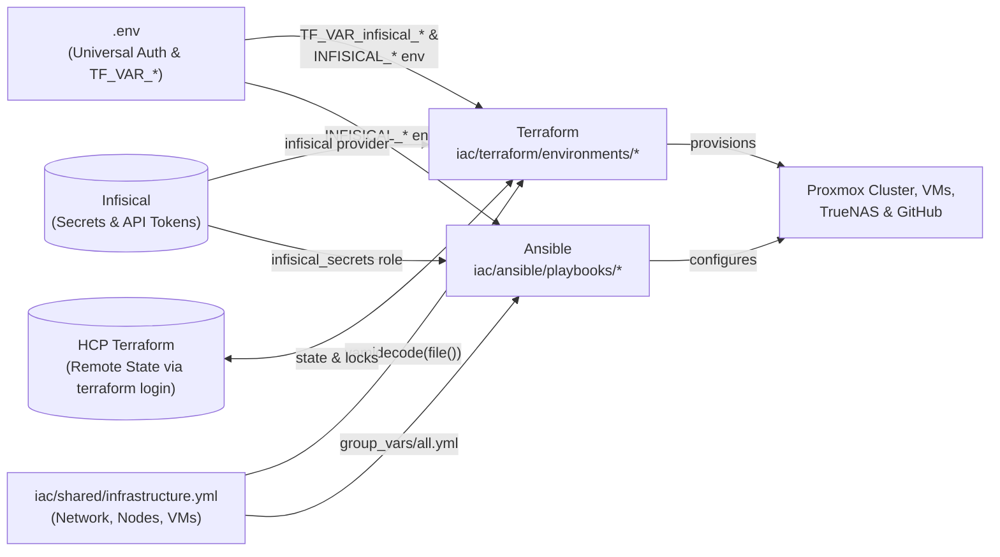

# RWD.Infrastructure

Infrastructure as Code (IaC) repository for provisioning, configuring, and operating Real World Developers (RWD) homelab and GitHub infrastructure.

- **Terraform (`iac/terraform/`):** Provisions Proxmox VE virtual machines and GitHub organization resources (repositories, teams, branch protection, `CODEOWNERS`), with remote state in HCP Terraform.
- **Ansible (`iac/ansible/`):** Configures base Linux hosts, Docker platforms, TrueNAS storage, containerized services, and Proxmox cluster UPS/NUT orchestration.
- **Shared Topology (`iac/shared/infrastructure.yml`):** Single source of truth for non-secret network, Proxmox node, and VM topology consumed by both Terraform and Ansible.
- **Makefile:** Universal CLI entry point that loads `.env`, maps Infisical Universal Auth credentials to `TF_VAR_*`, exports `ANSIBLE_CONFIG`, and wraps Terraform/Ansible workflows.

---

## Architecture



---

## Prerequisites

1. **Terraform CLI & HCP Terraform Auth:**
   ```bash
   brew install terraform
   terraform login
   ```
   > [!IMPORTANT]
   > The HCP Terraform user API token (`~/.terraform.d/credentials.tfrc.json`) is stored locally via `terraform login`—**not** in Infisical.

2. **Ansible & Required Collections:**
   ```bash
   brew install ansible
   ansible-galaxy collection install -r iac/ansible/collections/requirements.yml
   ```
   Installs `community.docker` and `infisical.vault`.

3. **Environment File (`.env`):**
   Copy [.env.example](.env.example) to `.env` (gitignored) and populate at minimum the Infisical Universal Auth credentials:
   - `INFISICAL_CLIENT_ID`
   - `INFISICAL_CLIENT_SECRET`
   - `INFISICAL_PROJECT_ID`

   The root [Makefile](Makefile) loads `.env` automatically and exports `TF_VAR_infisical_client_id`, `TF_VAR_infisical_client_secret`, and `TF_VAR_infisical_project_id`.

---

## Repository Layout

```text
RWD.Infrastructure/
├── Makefile                        # Universal Terraform, Ansible, and VM-templating entry point
├── README.md                       # This file
├── AGENTS.md                       # AI agent project rules and verified commands
├── .env.example                    # Example environment/Infisical variables (copy to .env)
├── cleanup_vm.sh                   # Seals a VM before Proxmox template conversion
├── convert_to_template.sh          # Converts a sealed Proxmox VM into a template
├── iac/
│   ├── shared/
│   │   └── infrastructure.yml      # Shared network, Proxmox node, and VM topology
│   ├── terraform/
│   │   ├── README.md               # Terraform guide, HCP auth, and template workflow
│   │   ├── environments/           # Isolated Terraform roots (github/*, proxmox/*, infisical/)
│   │   └── modules/                # Reusable GitHub and Proxmox modules
│   └── ansible/
│       ├── README.md               # Ansible guide, variable precedence, and workflow
│       ├── ansible.cfg             # Portable relative Ansible config
│       ├── collections/            # Galaxy requirements (community.docker, infisical.vault)
│       ├── inventories/            # hosts.yml, truenas.yml, group_vars/
│       ├── playbooks/              # Service, base, maintenance, and Infisical test playbooks
│       └── roles/                  # Modular roles (system_base, docker, proxmox, truenas, apps)
└── .agents/                        # Project standards, memory/handoffs, templates, and skills
```

---

## Terraform Workflow

Always run Terraform through the root `Makefile` (never raw `terraform` commands from the repo root) so `.env` and `TF_VAR_infisical_*` exports are applied consistently.

```bash
# 1. Initialize & format a target environment
make init TARGET=proxmox/pve-p01

# 2. Preview changes (writes tfplan in the target directory)
make plan TARGET=proxmox/pve-p01

# 3. Apply the saved plan
make apply TARGET=proxmox/pve-p01

# Format / validate / clean temporary files
make fmt TARGET=proxmox/pve-p01
make validate TARGET=proxmox/pve-p01
make clean TARGET=proxmox/pve-p01
```

Available `TARGET` paths under `iac/terraform/environments/`:
- `proxmox/proxmox`, `proxmox/pve-d01`, `proxmox/pve-p01`
- `github/realworlddevelopers`, `github/rwdevlead`
- `infisical`

See [iac/terraform/README.md](iac/terraform/README.md) for module details and Proxmox VM template creation steps.

---

## Ansible Workflow

Always run the `-check` target (`--check --diff`) before applying changes. The `Makefile` automatically exports `ANSIBLE_CONFIG=iac/ansible/ansible.cfg`.

### 1. Verify Config & Infisical Access

```bash
make ansible-config
make test-infisical
```

### 2. Provision Hosts & Services

```bash
# Base OS configuration & Docker platform
make base-check       && make base
make docker-check     && make docker
make setup-updates

# Core services & applications
make traefik-check    && make traefik
make mailrise-check   && make mailrise
make pihole-check     && make pihole
make nebula-check     && make nebula
make portainer-check  && make portainer
make portainer-agent-check && make portainer-agent
make homarr-check     && make homarr
make uptime-kuma-check && make uptime-kuma
make pulse-check      && make pulse
make watchtower-check && make watchtower

# Storage & Proxmox cluster UPS/NUT
make truenas-check    && make truenas
make ups-nut-check    && make ups-nut
```

> [!NOTE]
> `make docker`, `make setup-updates`, and `make run-upgrade` currently pass `--limit dev-docker-02` in `Makefile`. See [iac/ansible/README.md](iac/ansible/README.md) and [iac/ansible/playbooks/README.md](iac/ansible/playbooks/README.md) for full details.

---

## Make Target Reference

Run `make help` to display targets directly from the `Makefile`:

| Category | Targets |
| :--- | :--- |
| **General** | `help`, `check-tf-vars` |
| **Terraform (`TARGET=<path>`)** | `init`, `plan`, `apply`, `validate`, `fmt`, `clean`, `destroy` |
| **Proxmox VM Templating** | `cleanup-vm`, `convert-to-template` |
| **Ansible Diagnostics** | `ansible-config`, `test-infisical` |
| **Ansible Base & Updates** | `base-check`, `base`, `setup-updates`, `run-upgrade` |
| **Ansible Docker & Storage** | `docker-check`, `docker`, `truenas-check`, `truenas` |
| **Ansible Proxmox Cluster** | `ups-nut-check`, `ups-nut` |
| **Ansible Applications** | `traefik{-check}`, `mailrise{-check}`, `pihole{-check}`, `nebula{-check}`, `portainer{-check}`, `portainer-agent{-check}`, `homarr{-check}`, `uptime-kuma{-check}`, `pulse{-check}`, `watchtower{-check}` |

---

## Secrets & Authentication Model

- **Infisical (Universal Auth):** Stores infrastructure secrets, API tokens, mail credentials, and service passwords. Loaded via `.env` (`INFISICAL_CLIENT_ID`, `INFISICAL_CLIENT_SECRET`, `INFISICAL_PROJECT_ID`).
  - Terraform environments use the `infisical` provider.
  - Ansible playbooks use the `infisical_secrets` role (`infisical.vault` collection) to populate the runtime `secrets.*` fact.
- **HCP Terraform Token:** Generated locally with `terraform login` and stored in `~/.terraform.d/credentials.tfrc.json` (not in Infisical).
- **Non-Secret Topology:** IPs, subnets, Proxmox node names/aliases, and VM IDs belong in [iac/shared/infrastructure.yml](iac/shared/infrastructure.yml), never hardcoded across environments or roles.

---

## macOS Notes

- On macOS, Python or native extensions initializing the Objective-C runtime can trigger `fork()` safety errors during local Ansible plugin lookups.
- `make test-infisical` sets `OBJC_DISABLE_INITIALIZE_FORK_SAFETY=YES` for that command. If running local `ansible-playbook -c local` commands manually, prefix them with `OBJC_DISABLE_INITIALIZE_FORK_SAFETY=YES`.
